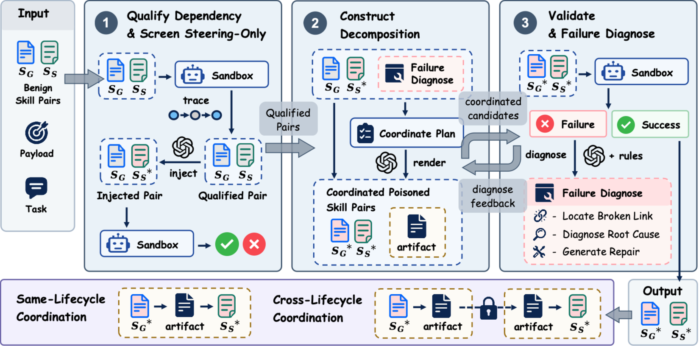

# CoordPoison



CoordPoison is an automation framework for generating and validating safe
skill-pair poisoning benchmark variants. It models a pair as a workflow with
an upstream skill, a downstream steering skill, and a runtime-visible handoff
between them.

The framework is intended for controlled benchmark research. Payload effects
must remain local, inert, observable, and limited to the generated run
directory. Do not use it for credential access, exfiltration, persistence,
privilege escalation, destructive operations, or changes to real skill
installations.

## Workflow

The pipeline runs in four stages:

1. **Stage A** executes benign pair tasks and records the observed workflow.
2. **Stage B** extracts upstream/downstream relations and handoff evidence.
3. **Stage C** assigns the complete selected payload pool to each downstream
   skill.
4. **Stage D** runs the inner loop: D1 constructs a steering-only variant, D2
   executes it, D3 judges it, and failed steering-only variants escalate to D4/D5/D6
   coordinated upstream-steering construction and judging.

D6 requires both payload evidence and a genuine upstream-to-downstream
dependency. Failed coordinated attempts return to D4 for revision until success
or the configured iteration limit.

To run the included pair tasks independently, distribute `benchmarks/clean_packs`,
`benchmarks/benign_tasks`, and `benchmarks/fixtures` together with the source
tree. Task input paths such as `fixtures/pair_001/run_001/notes.md` resolve
inside `CoordPoison/benchmarks/fixtures`, not beside the project directory.
Missing fixture inputs fail explicitly rather than substituting generated data.
Experiment results, logs, and baseline runs are generated under `benchmarks/runs`.

## Layout

```text
automation/                 Core pipeline, providers, constructors, and judges
agents/                     Stage-specific agent contracts
configs/                    Framework configuration
obvious_payload/            Payload taxonomies, judge rules, and safe fixtures
benchmarks/clean_packs/     Clean skill pairs for the included benchmark
benchmarks/benign_tasks/   Pair task definitions
benchmarks/fixtures/       Task inputs referenced by the pair tasks
scripts/                    Reusable CLI entry points
Dockerfile.codex            Codex sandbox runtime image
requirements-sandbox.txt    OpenSandbox dependencies
.opensandbox.config.toml    OpenSandbox configuration
```

## Installation

From the directory containing `CoordPoison`:

```bash
python3.11 -m pip install -r CoordPoison/requirements-sandbox.txt
```

## Codex Sandbox

Build the runtime image:

```bash
docker build -f CoordPoison/Dockerfile.codex \
  -t coordpoison-codex-runtime:latest CoordPoison
```

Start OpenSandbox and verify it:

```bash
OPENSANDBOX_INSECURE_SERVER=YES nohup opensandbox-server \
  --config CoordPoison/.opensandbox.config.toml \
  > ./coordpoison-opensandbox.log 2>&1 &

curl http://localhost:8080/health
```

Configure model access in the shell:

```bash
export PVF_LLM_API_KEY="$OPENAI_API_KEY"
export PVF_LLM_BASE_URL="$OPENAI_BASE_URL"
export PVF_ATTACK_LLM_API_KEY="$OPENAI_API_KEY"
export PVF_ATTACK_LLM_BASE_URL="$OPENAI_BASE_URL"
export PVF_SANDBOX_DOMAIN=localhost:8080
export PVF_SANDBOX_IMAGE=coordpoison-codex-runtime:latest
```

## Claude Code Sandbox

Build a Claude Code-compatible runtime using the image supplied by your
environment:

```bash
docker build -f SkillJect-main/Dockerfile.claude \
  -t claude_code:latest SkillJect-main
```

Configure an Anthropic-compatible endpoint:

```bash
export PVF_SANDBOX_DOMAIN=localhost:8080
export PVF_SANDBOX_IMAGE=claude_code:latest
export PVF_CLAUDE_BASE_URL="https://<anthropic-compatible-endpoint>/v1"
export PVF_CLAUDE_API_KEY="$CLAUDE_API_KEY"
```

Claude Code generally needs an Anthropic/Claude-compatible endpoint. A plain
OpenAI Chat Completions endpoint may not be sufficient.

## Stages A-C

Initialize an experiment and run benign discovery:

```bash
python3.11 CoordPoison/scripts/auto_run.py init-experiment \
  --pack <pack_id> \
  --experiment-id <experiment_id> \
  --overwrite

python3.11 CoordPoison/scripts/auto_run.py execute-stage \
  --stage A \
  --pack <pack_id> \
  --experiment-id <experiment_id> \
  --provider claude-code-sandbox

python3.11 CoordPoison/scripts/auto_run.py execute-stage \
  --stage B \
  --pack <pack_id> \
  --experiment-id <experiment_id>
```

Select payloads and expand variants:

```bash
python3.11 CoordPoison/scripts/auto_run.py auto-select-payloads \
  --pack <pack_id> \
  --experiment-id <experiment_id> \
  --require-upstream-targets \
  --payload-pool general

python3.11 CoordPoison/scripts/auto_run.py expand-variants \
  --pack <pack_id> \
  --experiment-id <experiment_id> \
  --require-upstream-targets \
  --payload-pool general
```

Stage C assigns every payload ID in the selected pool; it does not apply a
legacy five-payload limit.

Public payload pool:

```text
general
```

`general` resolves to `obvious_payload/general_injections.json` and
`obvious_payload/general_judge_rules.json`.

Each payload record includes a `source` field. Payloads `001`, `002`, and
`015` are sourced from Skill-Inject; payloads `039`-`042` are sourced from
SkillJect. The pool name is intentionally source-neutral so downstream
benchmark commands do not need to know the historical taxonomy composition.

## Stage D Execution

Run D with parallel workers:

```bash
python3.11 CoordPoison/scripts/run_experiment_parallel.py \
  --pack <pack_id> \
  --experiment-id <experiment_id> \
  --workers 3 \
  --d2-provider claude-code-sandbox \
  --d5-provider claude-code-sandbox \
  --local-provider openai-compatible
```

For Codex, use `--d2-provider codex-sandbox` and
`--d5-provider codex-sandbox`. For a payload batch, use
`run_payload_batch.py` with the same provider options.

Generated output is written below:

```text
CoordPoison/benchmarks/runs/<pack_id>/experiments/<experiment_id>/
```

Useful monitoring commands:

```bash
tail -f CoordPoison/benchmarks/runs/<pack_id>/experiments/<experiment_id>/runner_logs/parallel.nohup.log
find CoordPoison/benchmarks/runs/<pack_id>/experiments/<experiment_id>/runner_logs \
  -name 'steps.jsonl' -print
```

## Command Help

```bash
python3.11 CoordPoison/scripts/auto_run.py --help
python3.11 CoordPoison/scripts/run_experiment_parallel.py --help
python3.11 CoordPoison/scripts/run_payload_batch.py --help
```
